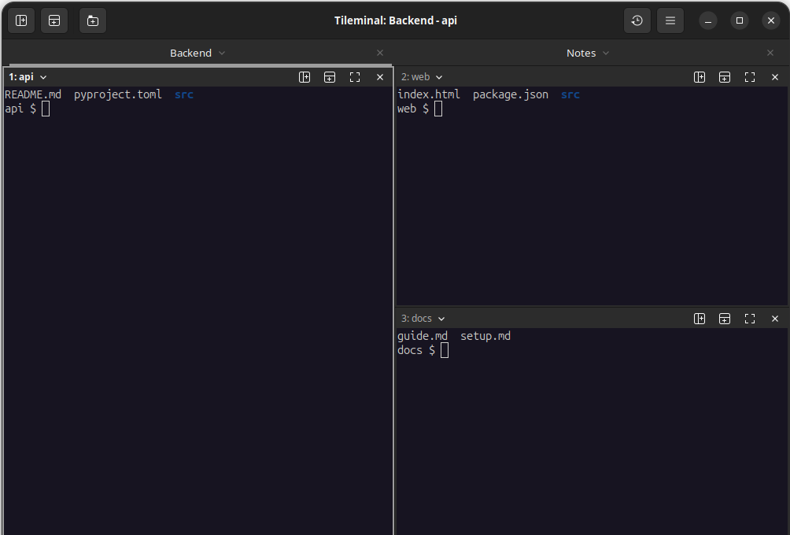

# Tileminal

A terminal for Linux with tabs, splits, and a memory: close it, reboot, open it again,
and your windows, tabs, splits and folders are all where you left them.



## Install

On a standard Ubuntu desktop (24.04 and newer) everything it needs is already installed:

```sh
git clone https://github.com/realjjaveweb/tileminal.git
cd tileminal
sh install.sh
```

It asks whether to pin Tileminal to the dock; after that it's in the app grid like any other app, and
`tileminal` works in a terminal.

`install.sh` only creates the `tileminal` command, the menu entry and the icon; the app itself runs from the
folder you cloned, so `git pull` updates it. `sh install.sh --uninstall` removes it again. You can also skip
installing and just run `python3 tileminal` from the folder.

If something is missing, the installer tells you. On Debian and Ubuntu that's:

```sh
sudo apt install python3-gi python3-gi-cairo gir1.2-gtk-3.0 gir1.2-vte-2.91
```

## How to use it

- **Split** a terminal with the two buttons at the top left, or Ctrl+Shift+E (right) and Ctrl+Shift+O (down).
  Each split terminal gets a small title bar with its own split, maximize and close buttons.
- **Rearrange** by dragging a terminal's title bar onto another terminal. Drop it on an edge to put it on that
  side, or in the middle to swap the two.
- **Rename** a tab or a terminal with the little ⌄ next to its title. Leave the name empty to go back to the
  terminal's own title.
- **Reopen** something you closed by accident with the clock button, or Ctrl+Shift+Z for the last one.
- **Quit All** (in the menu, or *Quit* on the dock icon) closes everything and brings all of it back next time.
- **Save a tab** to a file, or open one as a new tab, from the menu - handy for layouts you set up often.

### Shortcuts

| Keys | |
| --- | --- |
| Ctrl+Shift+E / Ctrl+Shift+O | Split right / down |
| Ctrl+Shift+W | Close terminal |
| Alt+arrows | Move between terminals |
| Ctrl+Shift+T | New tab |
| Ctrl+PgUp / Ctrl+PgDn | Previous / next tab |
| Ctrl+Shift+PgUp / Ctrl+Shift+PgDn | Move tab left / right |
| Alt+1 … Alt+9 | Jump to tab |
| Ctrl+Shift+N | New window |
| Ctrl+Shift+Q | Close window |
| Ctrl+Shift+Z | Reopen the last closed terminal, tab or window |
| Ctrl+Shift+C / Ctrl+Shift+V | Copy / paste |
| Ctrl+Plus / Ctrl+Minus / Ctrl+0 | Zoom |

Ctrl+click opens links. Double-click a tab to rename it, middle-click to close it.

## What comes back

| You... | Next start |
| --- | --- |
| log out, reboot, crash, or use Quit All | everything |
| close the last window and it has splits or tabs | that window |
| close the last window and it's a single terminal | a fresh window |
| close a terminal, a tab or one of several windows | nothing - it's in the closed list |

The session is saved to `~/.local/state/tileminal/session.json` whenever something changes. A new version only
replaces the old one after it has been written and read back successfully, and the last 10 versions are kept
in `history/` next to it, so a crash or a full disk can't wipe your layout.

## Settings

`~/.config/tileminal/config.json`, created on the first start. Open it from the menu and use *Reload Config*
after editing.

| Setting | Default | |
| --- | --- | --- |
| `font` | `null` | e.g. `"Monospace 12"`; `null` follows the desktop's monospace font |
| `color_scheme` | `"dark"` | `"dark"`, `"light"`, or your own `{"foreground", "background", "palette"}` |
| `cursor_shape` | `"block"` | `"block"`, `"ibeam"` or `"underline"` |
| `scrollback_lines` | `10000` | |
| `pane_headers` | `"splits"` | title bars only on split terminals, or `"always"` |
| `closed_history` | `20` | how many closed things to remember |
| `session_history` | `10` | how many old session versions to keep |
| `autosave_interval` | `5` | seconds |

## Command line

```
tileminal                    restore the last session
tileminal --fresh            start empty
tileminal -w DIR             open a window in DIR
tileminal --session FILE     open a saved session file as a tab
```

Each shell gets a `TERMINAL_PANE_ID` environment variable that stays the same across restarts, handy for
per-terminal history files or scripts.

## Contributing

Setup, the checks to run, tests, code layout and translations are in [CONTRIBUTING.md](CONTRIBUTING.md).

## License

[MIT](LICENSE)
